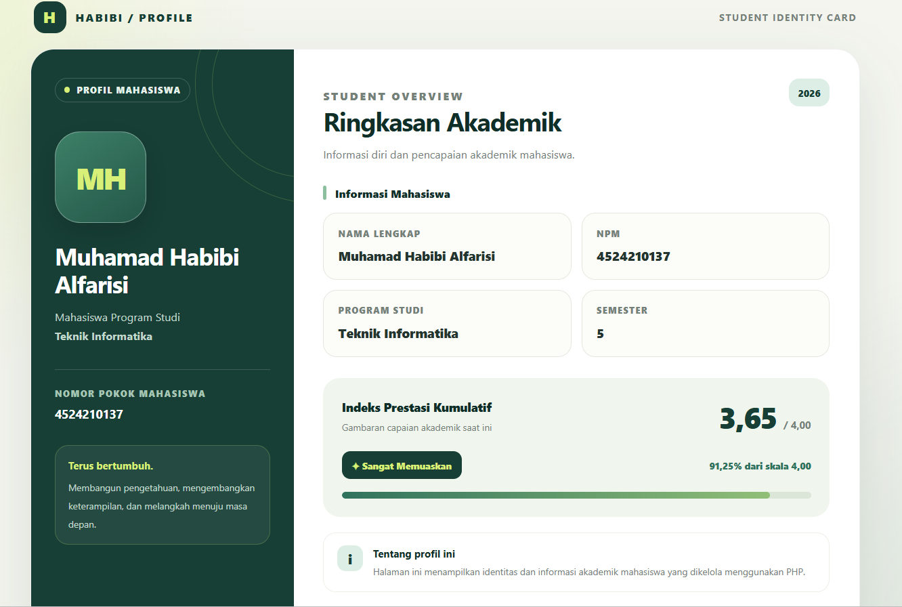
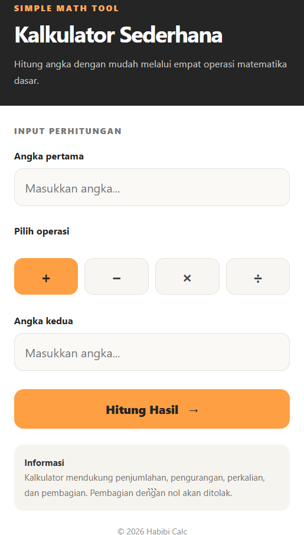

# Web Programming Lab | Praktikum 01–02

**Muhamad Habibi Alfarisi**  
**NPM:** 4524210137  
**Program Studi:** Teknik Informatika

## Tentang Proyek

Repository ini merupakan dokumentasi pengerjaan praktikum awal mata kuliah Pemrograman Berbasis Web. Proyek mencakup dua aplikasi sederhana yang dibuat untuk mempraktikkan konsep dasar pengembangan website menggunakan PHP dan teknologi web pendukung.

Aplikasi yang dikembangkan adalah **Profil Mahasiswa** dan **Kalkulator Aritmatika**. Masing-masing memiliki fungsi berbeda, mulai dari menyajikan informasi akademik hingga memproses operasi matematika berdasarkan input pengguna.

## Aplikasi yang Dibuat

### A. Student Profile

Halaman profil dirancang sebagai tampilan informasi mahasiswa dalam format yang terstruktur. Informasi akademik disajikan dalam beberapa bagian agar identitas dan ringkasan pencapaian mudah ditemukan.

Data yang ditampilkan:
- Nama mahasiswa
- Nomor Pokok Mahasiswa
- Program studi
- Semester
- IPK dan informasi pencapaian akademik

Tampilan menggunakan pembagian area konten dan kartu informasi untuk memberikan susunan visual yang lebih teratur.

### B. Simple Math Tool

Aplikasi kalkulator digunakan untuk menghitung dua bilangan berdasarkan operator yang dipilih. Pengguna memasukkan angka pertama dan kedua, kemudian menentukan operasi yang ingin dilakukan.

Fungsi perhitungan mencakup:

| Operator | Operasi |
|---|---|
| `+` | Penjumlahan |
| `-` | Pengurangan |
| `*` atau `×` | Perkalian |
| `/` atau `÷` | Pembagian |

Input perlu divalidasi sebelum perhitungan diproses. Khusus operasi pembagian, nilai pembagi nol harus ditangani agar aplikasi tidak menghasilkan perhitungan yang tidak valid.

## Konsep yang Dipelajari

Praktikum ini digunakan untuk mengenal beberapa konsep penting dalam pengembangan web:

- **PHP:** menjalankan logika pemrosesan data di sisi server.
- **HTML:** membangun elemen dan struktur halaman.
- **CSS:** mengatur desain dan tata letak antarmuka.
- **HTTP GET dan POST:** memahami dua metode yang digunakan untuk pertukaran data antara browser dan server.
- **Input validation:** memeriksa masukan pengguna sebelum data diproses.

Teknologi yang benar-benar digunakan dapat disesuaikan dengan implementasi pada masing-masing aplikasi.

## Susunan Proyek

```text
Pertemuan1&2/
├── Biodata/
│   └── Program profil mahasiswa
├── Kalkulator/
│   └── Program kalkulator
└── README.md
```

Susunan di atas merupakan ilustrasi. Nama folder dan file perlu mengikuti struktur aktual proyek.

## Menjalankan Aplikasi Secara Lokal

### Persiapan lingkungan

1. Instal XAMPP dan pastikan Apache tersedia.
2. Tempatkan folder proyek di dalam direktori `htdocs`.
3. Jalankan Apache melalui XAMPP Control Panel.
4. Buka browser untuk mengakses aplikasi melalui `localhost`.

### Pengujian profil

Buka halaman profil mahasiswa melalui alamat lokal sesuai lokasi file. Periksa apakah data identitas dan informasi akademik tampil dengan benar.

### Pengujian kalkulator

1. Masukkan bilangan pertama.
2. Tentukan operasi aritmatika.
3. Masukkan bilangan kedua.
4. Jalankan proses perhitungan.
5. Bandingkan hasil yang ditampilkan dengan hasil perhitungan yang benar.

Lakukan pengujian pada beberapa operasi, termasuk pembagian dengan nol untuk memeriksa penanganan input yang tidak valid.

## Dokumentasi Hasil

Tambahkan screenshot dari aplikasi yang benar-benar dijalankan pada komputer.

**Profil Mahasiswa**



**Kalkulator**



Nama dan lokasi gambar di atas merupakan contoh. Sesuaikan tautan dengan file screenshot yang tersedia.

## Evaluasi Praktikum

Untuk melengkapi laporan, dokumentasikan hasil evaluasi berikut berdasarkan pengerjaan yang benar-benar dilakukan:

1. Modifikasi yang diterapkan pada program.
2. Bagian kode penting beserta penjelasan fungsinya.
3. Hasil pengujian sebelum dan sesudah modifikasi.
4. Kendala yang ditemukan, penyebabnya, dan langkah perbaikannya.

Bagian evaluasi ini dapat diisi dengan bukti dari proses pengerjaan masing-masing.

## Kesimpulan

Pembuatan profil mahasiswa dan kalkulator memberikan latihan awal dalam menyusun halaman web serta mengolah input menggunakan logika program. Melalui kedua aplikasi tersebut, konsep dasar PHP, struktur HTML, pengaturan tampilan, dan metode pertukaran data web dapat dipelajari melalui implementasi sederhana.

---

**Nama:** Muhamad Habibi Alfarisi  
**NPM:** 4524210137  
**Mata Kuliah:** Pemrograman Berbasis Web
